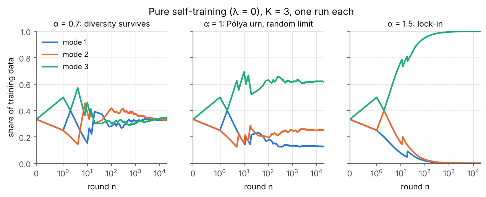
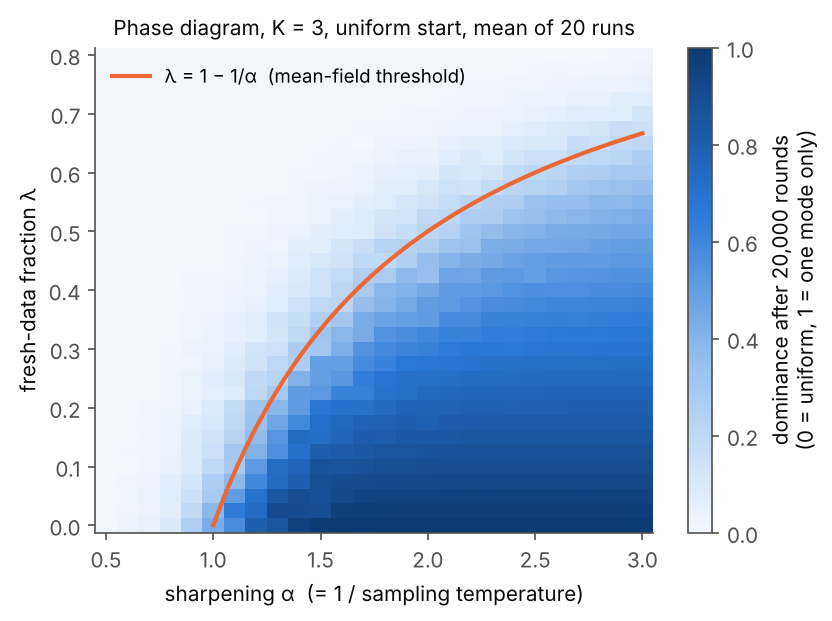
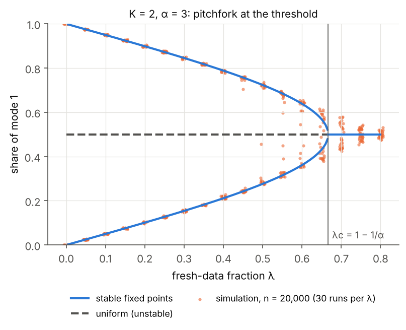

# Self-training loops as non-linear urns

When generative models are trained on data that partly comes from earlier models, their outputs feed back into their own training data. This repository studies the simplest version of that feedback loop: a reinforced process (a generalised Pólya urn) in which **sharpened sampling** and a **fraction of fresh data** compete. Even this toy model shows a sharp phase transition between *diversity surviving* and *lock-in to one mode*.

## The model

A "model" over $K$ modes is the empirical distribution of its training data, given by counts $N_1(n), \dots, N_K(n)$. In each round one data point is added:

- with probability $1-\lambda$ it is **generated by the model**, sampled at temperature $T = 1/\alpha$, so mode $i$ is chosen with probability
  $$\frac{N_i(n)^{\alpha}}{\sum_j N_j(n)^{\alpha}};$$
- with probability $\lambda$ it is **fresh data** from a fixed distribution $\pi$ (uniform here).

Data accumulates and is never discarded. Here $\alpha > 1$ stands for anything that sharpens the model's output before it is reused (low-temperature sampling, best-of-$k$ style curation), and $\lambda$ for the share of genuinely new data. With $\lambda = 0$ this is the classical non-linear urn with feedback $x \mapsto x^\alpha$:

- $\alpha < 1$: shares converge to uniform (diversity survives);
- $\alpha = 1$: Pólya urn, shares converge to a random (Dirichlet) limit;
- $\alpha > 1$: almost surely one mode takes all but finitely many draws (monopoly).



## A threshold for fresh data

Writing $x_i = N_i / \sum_j N_j$ for the shares, the expected increment is driven by the mean-field drift
$$F(x) = (1-\lambda)\, g(x) + \lambda \pi - x, \qquad g_i(x) = \frac{x_i^\alpha}{\sum_j x_j^\alpha}.$$
The uniform point $u = (1/K, \dots, 1/K)$ is always a zero of $F$. A short calculation gives $\partial g_i/\partial x_j(u) = \alpha(\delta_{ij} - 1/K)$, so for every direction $v$ in the simplex ($\sum_i v_i = 0$)
$$DF(u)\, v = \big((1-\lambda)\alpha - 1\big)\, v .$$
Hence the uniform state is linearly stable if and only if
$$\lambda > \lambda_c(\alpha) = 1 - \frac{1}{\alpha},$$
independently of $K$. For example, if outputs are sharpened with $\alpha = 2$, at least half of each new batch must be fresh data to keep diversity stable.



Simulations (20,000 rounds, uniform start) agree with the curve away from it. Near the threshold, convergence is slow, which blurs the boundary at finite $n$.

## What happens at the threshold

For $K = 2$ the transition is a supercritical pitchfork. Below $\lambda_c$ the uniform state is unstable and the shares settle near one of two symmetric lock-in states, which merge continuously into the uniform state as $\lambda \uparrow \lambda_c$.



For $K \ge 3$, the mean-field dynamics started from a strongly biased state can stay locked in **slightly beyond** $\lambda_c$. Numerically, the window grows with $K$ (for $\alpha = 3$: lock-in persists up to about $\lambda \approx 0.68$ for $K = 3$ and $0.72$ for $K = 5$, versus $\lambda_c \approx 0.667$). So for many modes the transition appears to be discontinuous with hysteresis: once a loop has collapsed, restoring the fresh-data fraction to just above $\lambda_c$ need not undo it.

## Open questions

- **Rigorous limit theorems.** Almost-sure convergence of the shares to stable zeros of $F$, and non-convergence to the unstable uniform point below $\lambda_c$, should follow from stochastic-approximation methods. The case of interest is the behaviour exactly at and near $\lambda_c$: the time to lock-in and the critical scaling.
- **Hysteresis for $K \ge 3$.** Identify the second threshold beyond which lock-in states disappear, and its dependence on $K$ and $\alpha$.
- **Curation with a reward model.** Replace sharpening by best-of-$k$ selection under a noisy proxy reward, and ask when the loop locks into the proxy's favourite rather than the true best mode (a Goodhart version of the same question).
- **Performative prediction.** Here the "predictions" (generated samples) become future training data. Under what conditions does such a loop stay calibrated to $\pi$?

## Usage

```bash
pip install -r requirements.txt
python tests/test_urnloop.py      # or: pytest
python scripts/make_figures.py    # regenerates figures/ (about a minute)
```

The core simulation is `src/urnloop.py`. It is vectorised over parameters and independent runs, so a whole phase diagram is a single call to `simulate`.

## Related work

- B. M. Hill, D. Lane, W. Sudderth, *A strong law for some generalized urn processes*, Ann. Probab. (1980).
- R. Pemantle, *A survey of random processes with reinforcement*, Probab. Surveys (2007).
- R. I. Oliveira, *The onset of dominance in balls-in-bins processes with feedback*, Random Structures & Algorithms (2009).
- I. Shumailov et al., *AI models collapse when trained on recursively generated data*, Nature (2024).
- Q. Bertrand et al., *On the stability of iterative retraining of generative models on their own data*, ICLR (2024).
- M. Gerstgrasser et al., *Is model collapse inevitable? Breaking the curse of recursion by accumulating real and synthetic data* (2024).
- J. Perdomo, T. Zrnic, C. Mendler-Dünner, M. Hardt, *Performative prediction*, ICML (2020).

## Acknowledgement

The code and figures in this repository were written with the help of Claude (Anthropic); the model, analysis and open questions are my own.

## License

MIT
